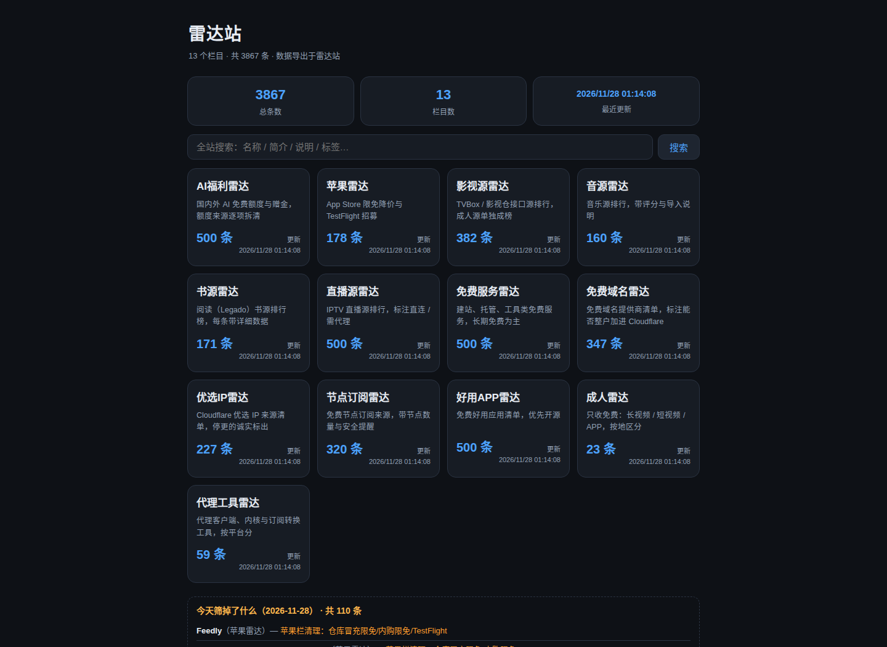

# 雷达站 · ym-radar

一个**全自动的免费资源雷达站**：13 个栏目、3800+ 条资源，全部由脚本自动采集、自动验活、自动清理——没人管它，它也能自己一直更新、一直活着。站点是纯静态页（`index.html` + `data.json`），部署在 Cloudflare Pages 上，仓库推什么它显示什么，每月花费 0 元。

        

**[13 个栏目一览](#13-个栏目一览) · [自动更新机制](#它怎么保证一直活着) · [自己搭一个](#自己搭一个fork--部署) · [仓库结构](#仓库结构)**

> 本仓库就是站点的全部：数据、页面、采集脚本都在这里，没有另外的服务器和数据库。想看它长什么样，看下面「效果预览」的截图——那是用本仓库的数据在本地渲染出的真实界面。

## 效果预览

首页一眼看全：13 个栏目各有多少条、最近更新时间、全站搜索框，以及「今天筛掉了什么」——当天被自动下架的条目和原因都列在明面上。

## 功能一览

| 功能 | 说明 |
|---|---|
| 全站搜索 | 按名称 / 简介 / 说明 / 标签，一次搜全部 13 个栏目 |
| 分类浏览 | 点栏目卡片进列表，条目可点开看详情（地址、来源、细节标签），地址一键复制 |
| 自动采集 | 每 6 小时从多个独立源头发现新条目，先验活、再把介绍挖全才上架 |
| 自动验活 | 每轮全量重验：不只看链接通不通，订阅 / 接口 / 书源这类抓回来 0 条也算坏 |
| 自动清理 | 连续验活失败够次数自动下架；苹果限免每轮按现价复核，过期降组或下架 |
| 今日筛掉 | 首页列出当天被筛掉的条目和原因，下架了谁、为什么，一眼看清 |
| 失败自报 | 采集工作流任一步失败，自动开一个带运行链接的 issue，不让失败悄悄过去 |

## 目录

- [效果预览](#效果预览)
- [功能一览](#功能一览)
- [13 个栏目一览](#13-个栏目一览)
- [它怎么保证一直活着](#它怎么保证一直活着)
- [全自动总览（保证最新、保证可用）](#全自动总览保证最新保证可用)
- [自己搭一个（Fork + 部署）](#自己搭一个fork--部署)
- [仓库结构](#仓库结构)
- [费用总账（不花钱，也不抢别人的额度）](#费用总账不花钱也不抢别人的额度)
- [万一它停了，去哪看、怎么手动弄](#万一它停了去哪看怎么手动弄)
- [许可证](#许可证)

## 13 个栏目一览

条数为 2026-11-28 的快照（合计 3867 条），实时数字以仓库 `data.json` 为准——它每 6 小时变一次。

| 栏目 | 条数 | 看什么 |
|---|---:|---|
| AI福利雷达 | 500 | 国内外 AI 免费额度与赠金，额度来源逐项拆清 |
| 苹果雷达 | 178 | App Store 限免降价与 TestFlight 招募 |
| 影视源雷达 | 382 | TVBox / 影视仓接口源排行，成人源单独成榜 |
| 音源雷达 | 160 | 音乐源排行，带评分与导入说明 |
| 书源雷达 | 171 | 阅读（Legado）书源排行榜，每条带详细数据 |
| 直播源雷达 | 500 | IPTV 直播源排行，标注直连 / 需代理 |
| 免费服务雷达 | 500 | 建站、托管、工具类免费服务，长期免费为主 |
| 免费域名雷达 | 347 | 免费域名提供商清单，标注能否整户加进 Cloudflare |
| 优选IP雷达 | 227 | Cloudflare 优选 IP 来源清单，停更的诚实标出 |
| 节点订阅雷达 | 320 | 免费节点订阅来源，带节点数量与安全提醒 |
| 好用APP雷达 | 500 | 免费好用应用清单，优先开源 |
| 成人雷达 | 23 | 只收免费：长视频 / 短视频 / APP，按地区分 |
| 代理工具雷达 | 59 | 代理客户端、内核与订阅转换工具，按平台分 |

每条条目的地址都是能直接用的东西（订阅链接、源文件、下载页、官网），仓库主页只作「来源」标注；同一个链接只进一个栏目，标题能看出是什么的进对应栏目，看不出的才进免费服务。

## 它怎么保证一直活着

这套东西的设计目标是：没人管它，它也能自己一直更新、一直活着。具体靠这几条：

1. **每 6 小时自己跑一轮。** 仓库里有个定时任务（GitHub Actions 的
   「自动采集（每 6 小时）」），一天跑 4 轮全量：挨个检查现有条目还活着没、
   更新数字（星标数、条数、苹果应用的现价和最新版本这些）、按源头清单去
   发现新条目、把连着多次检查都打不开的死条目换掉（苹果栏目 3 次约
   18 小时、其他栏目 6 次约 36 小时）、重新排榜。苹果限免每轮都按现价
   复核，过期了就降组或下架，不会一直挂在限免榜上。跑完有变化就自己
   提交、自己上线，全程不用人点。

2. **每次提交都是一份备份。** 数据每变一次就是一个 git 提交，仓库的提交
   历史里存着每一天的数据。哪天数据出问题，用 git 回退到任意一天的提交
   就能恢复，不会一坏全完。

3. **心跳防停用。** GitHub 有个规矩：仓库 60 天没动静，定时任务会被停掉。
   所以另有一个「每月心跳保活」任务，每月 1 号自动往仓库里写一次心跳
   文件并提交，保证仓库永远是「活跃」状态，定时任务不会被停。

4. **两个安全阀，坏数据绝不覆盖好数据。**
   - 一次检查里如果超过 30% 的条目都打不开（多半是网络或源头出大事），
     本次直接中止，什么都不写，站上还是昨天的好数据。
   - 一次运行如果要删除的条目超过全站的 25%（多半是某个源头被黑
     或挂了），同样直接中止不写。宁可今天不更新，也不能把全站删空。
   - 新增不设这道阀：只要是不重复的新条目，搜到多少就加进来多少，
     绝不因为「一次找到太多」就拦住不让进。
   - 提交前还有一道门禁校验（栏目齐不齐、介绍够不够长、破解类条目有没有
     风险警告、总数对不对得上），过不了就不提交。

5. **源头不止一个。** 每个栏目都配了好几个互相独立的发现源（GitHub 搜索、
   聚合清单、官方榜单、导航页）。单个源挂了只跳过它、记一笔日志，其他源
   照常；某个栏目这次一个新候选都没拉到，就保留它原来的数据原样不动。

6. **新条目验过才进。** 新增不另设每轮条数上限——搜到多少不重复的
  新条目就加多少，只受每栏总量上限 500 条约束（满了本轮就不再进）。
  但每条都要先验活、再把介绍挖全（是什么、干什么、有什么用、适合谁）
  才上架；原站介绍太水的，脚本会去深挖官方说明补全，实在挖不出实义
  内容的才放弃。

## 全自动总览（保证最新、保证可用）

一句话承诺：**每 6 小时全部重验一遍，坏的自动下架，新的验过才上。**

- 「验」不只看链接通不通，还看内容对不对：订阅、接口、书源、直播源、
  优选 IP 这类，抓回来数出 0 条的算坏，和死链一个待遇；软件类要下载页
  真实存在、版本号和价格对得上商店和官方发布页。
- 验不过的先记账：连续坏够次数（普通栏目 6 次、苹果栏目 3 次）自动
  下架，换验过的新条目顶上，下架名单写进当次的提交说明，谁被换了、
  为什么被换，一看就知道。
- 每次提交完，工作流还会去线上站抽查一遍（首页 + 随机 3 个栏目的
  数据），确认新数据真的上线、能打开能读；抽查不过会在日志里标红，
  但不回滚数据——多半只是部署延迟，下一轮自己就好了。
- **失败了会自己报。** 工作流里任何一步失败，会自动开一个带运行链接
  的 issue，不让失败悄悄过去没人知道。

## 自己搭一个（Fork + 部署）

想自己跑一份的话，整套东西都在这个仓库里，不需要任何私人令牌和服务器：

1. **Fork 本仓库**到你自己的 GitHub 名下。仓库自带的 `data.json` 就是一份
   现成数据，你的站一上线就有 3800+ 条内容打底，之后每轮采集在此基础上更新。
2. **启用 Actions。** GitHub 对 Fork 来的仓库默认禁用定时工作流：打开你
   Fork 后仓库的「Actions」页，把「自动采集（每 6 小时）」和「每月心跳保活」
   两个工作流启用。采集只用仓库自带的 `GITHUB_TOKEN` 给 GitHub API 提限额，
   不用配任何 Secret。
3. **部署站点。** 站点是纯静态的（仓库根目录的 `index.html` + `data.json`）：
   在 Cloudflare Pages 里连接你 Fork 的仓库，构建命令留空、输出目录填根
   目录 `/`，部署完即上线。换成任何静态托管（GitHub Pages、Netlify 等）也一样。
4. **想加自己的源**，改 `scripts/feeds.json`（发现新条目的源头清单），
   下一轮采集就会带上；栏目结构和门禁规则在 `scripts/collect.py` 和
   `scripts/validate.py` 里。

## 仓库结构

| 文件 | 是什么 |
|---|---|
| `index.html` | 站点本体（纯静态页，打开时读 `data.json` 渲染） |
| `data.json` | 全部数据：13 个栏目的条目都在这一个文件里 |
| `screened.json` | 「今天筛掉了什么」的数据 |
| `scripts/collect.py` | 自动采集脚本：发现、验活、挖介绍、排榜、清理 |
| `scripts/validate.py` | 提交前门禁：栏目、介绍长度、风险警告、总数对账 |
| `scripts/feeds.json` | 发现新条目的源头清单 |
| `scripts/state.json` | 每条条目的连续验活失败次数记账 |
| `scripts/ai_kb.json` / `scripts/vpn_kb.json` | AI 额度、免费 VPN 的人工核实知识库（数字不猜，查实了才写） |
| `data/apple_prices.json` | 苹果应用价格台账（原价靠它对账） |
| `.github/workflows/update.yml` | 「自动采集（每 6 小时）」：定时采集、门禁、提交、失败自报 |
| `.github/workflows/keepalive.yml` | 「每月心跳保活」：每月写一次心跳，防定时任务被停用 |

## 费用总账（不花钱，也不抢别人的额度）

- **构建次数：** 站点挂在 Cloudflare Pages 上，免费额度是每月 500 次
  构建。机器人每 6 小时跑一轮，但只有数据真有变化才提交、才触发构建，
  满打满算一个月约 120 次，占额度的四分之一，很宽裕。
- **KV / Workers 用量：0。** 本站是纯静态站，数据收集在 GitHub Actions
  里跑，仓库里就是全部数据；设计上写死不用 KV、不用 Workers、不用 D1，
  一次都不调用。所以它不会跟邮箱（ym-mail）、网盘（ym-pan）那些项目
  抢每天 1000 次的 KV 写额度——之前额度被搞炸过，这次从根上避开。
- **其他：** GitHub Actions 用仓库自带令牌和免费分钟数；源头全是公开
  免令牌的接口。整套东西每月花费 0 元。

### 万一它停了，去哪看、怎么手动弄

- **看状态：** 打开本仓库页面，点上方的「Actions」标签，里面能看到
  「自动采集（每 6 小时）」每一轮的运行记录：绿勾是成功，红叉是失败，
  点进去能看失败在哪一步。
- **手动跑一次：** 在「Actions」页左侧点「自动采集（每 6 小时）」，再点
  右边的「Run workflow」按钮，弹出的框里再点一次绿色的「Run workflow」，
  它就会立刻跑一次，不用等下一轮。
- **站点打不开先别慌：** 数据都存在这个仓库里，站点只是展示。先看
  Actions 是不是绿的；是绿的而站点打不开，多半是部署那边延迟或故障，
  数据没丢。

## 许可证

MIT，见 [LICENSE](LICENSE)。
